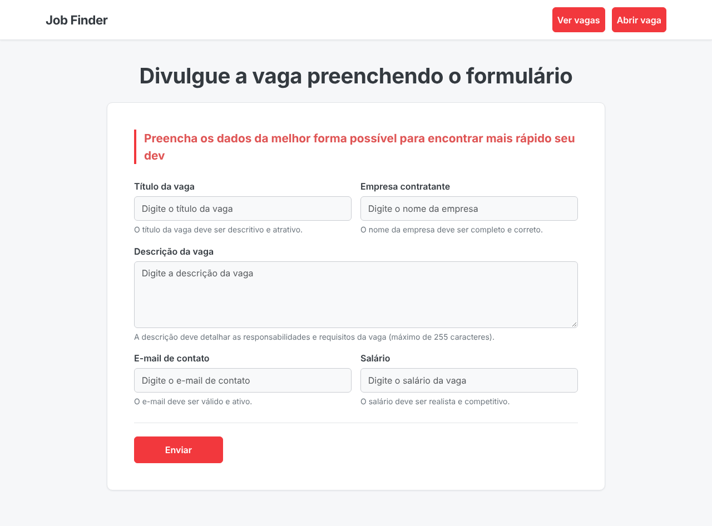
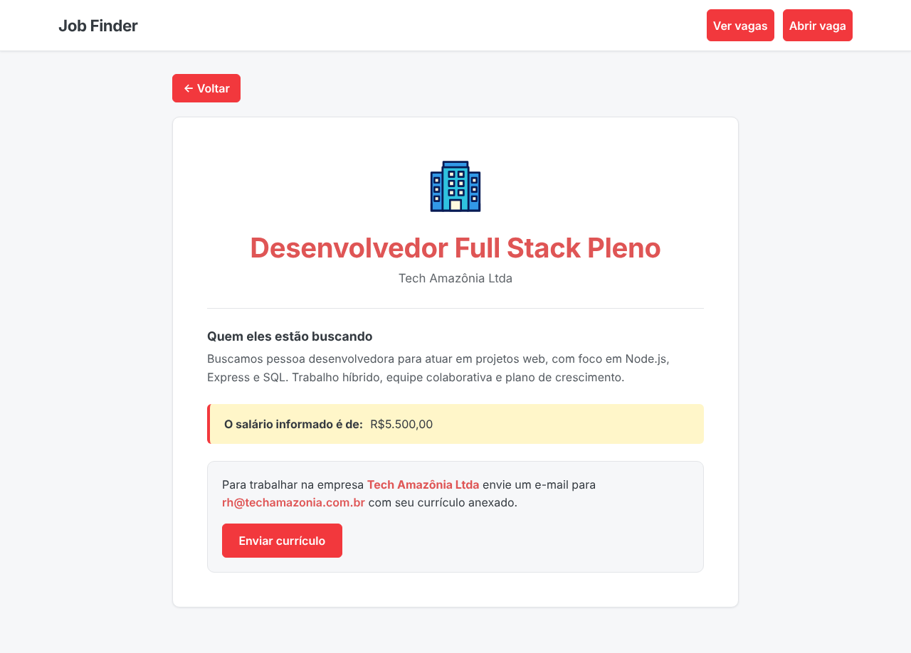
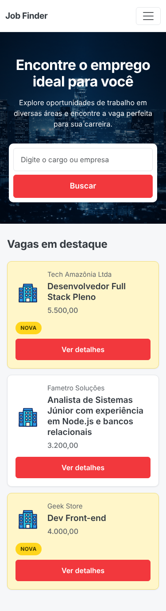

# JobFinder

Portal de vagas para programadores. Empresas publicam oportunidades por um formulário simples e quem procura emprego pode listar, buscar e ver os detalhes de cada vaga, com contato direto por e-mail.

Projeto desenvolvido durante um curso de JavaScript, com back-end em Node.js e interface responsiva (desktop, tablet e celular).


## Visual

<p align="center">
  
</p>

| Cadastro de vaga | Detalhes da vaga |
| :---: | :---: |
|  |  |

| Home no celular | Detalhes no celular |
| :---: | :---: |
|  |  |

> As capturas usam dados de exemplo.

## Funcionalidades

- **Listagem de vagas:** as mais recentes aparecem primeiro, e as vagas novas recebem destaque amarelo e o selo "Nova".
- **Busca:** pesquisa por título da vaga, com mensagem amigável quando nada é encontrado.
- **Detalhes da vaga:** descrição, salário informado e botão para enviar o currículo por e-mail.
- **Cadastro de vagas:** formulário com validação nativa do navegador (campos obrigatórios e e-mail válido).
- **Layout responsivo:** menu colapsável, busca e cards que se reorganizam em telas pequenas, com breakpoints para tablets e celulares.
- **Tratamento de erros:** resposta 404 para vagas inexistentes e 500 em falhas de consulta ao banco.

## Tecnologias

| Camada | Tecnologia |
| --- | --- |
| Servidor | Node.js + Express 5 |
| Templates | express-handlebars (layout principal + views) |
| Banco de dados | SQLite com Sequelize |
| Interface | HTML, CSS próprio e Bootstrap 5.3 (via CDN) |
| Desenvolvimento | nodemon |

## Como executar

### Requisitos

- [Node.js](https://nodejs.org/) e npm instalados
- Conexão com a internet (o Bootstrap é carregado por CDN)

### Passo a passo

1. Clone o repositório e entre na pasta:

   ```bash
   git clone https://github.com/RuanReymond/JobFinder-cursoJS-.git
   cd JobFinder-cursoJS-
   ```

2. Instale as dependências:

   ```bash
   npm install
   ```

3. Inicie o servidor:

   ```bash
   # modo desenvolvimento (reinicia ao salvar arquivos)
   npm run dev

   # ou, modo simples
   node app.js
   ```

4. Acesse [http://localhost:3000](http://localhost:3000) no navegador.

### Banco de dados

O banco é um arquivo SQLite local em `db/app.db`, com a tabela `jobs`. Se o arquivo não existir, crie a tabela com o comando abaixo (ele também cria o arquivo do banco):

```bash
node -e "require('./models/job').sync().then(() => process.exit())"
```

Campos da tabela `jobs`:

| Campo | Tipo | Descrição |
| --- | --- | --- |
| `id` | inteiro | Identificador automático |
| `title` | texto | Título da vaga |
| `description` | texto | Descrição, responsabilidades e requisitos (até 255 caracteres) |
| `company` | texto | Empresa contratante |
| `email` | texto | E-mail de contato para envio de currículo |
| `salary` | texto | Salário informado |
| `new_job` | inteiro | `1` para vagas novas (usado no destaque "Nova") |
| `createdAt` / `updatedAt` | data | Preenchidos automaticamente pelo Sequelize |

## Rotas

| Método | Rota | Descrição |
| --- | --- | --- |
| `GET` | `/` | Lista as vagas. Aceita `?job=termo` para buscar pelo título |
| `GET` | `/jobs/view/:id` | Exibe os detalhes de uma vaga (404 se não existir) |
| `GET` | `/jobs/add` | Exibe o formulário de cadastro |
| `POST` | `/jobs/add` | Salva a vaga e redireciona para a página inicial |
| `GET` | `/jobs/test` | Rota de teste que retorna "funcionando" |

## Estrutura do projeto

```text
.
├── app.js                  # Servidor Express, configuração do Handlebars e rota principal
├── package.json
├── db/
│   └── connection.js       # Conexão Sequelize com SQLite (app.db)
├── models/
│   └── job.js              # Modelo de vaga
├── routes/
│   └── jobs.js             # Rotas de vagas (/jobs)
├── views/
│   ├── layouts/main.hbs    # Layout base (head, navbar e scripts)
│   ├── index.hbs           # Home: busca e lista de vagas
│   ├── add.hbs             # Formulário de nova vaga
│   └── views.hbs           # Detalhes da vaga
├── public/
│   ├── css/styles.css      # Estilos e media queries
│   └── img/                # Banner e logo de empresa
└── docs/screenshots/       # Imagens usadas neste README
```

## Responsividade

Os estilos ficam em `public/css/styles.css`, organizados por seção, com as cores centralizadas em variáveis CSS no topo do arquivo. Os breakpoints usados são:

| Largura | Ajustes principais |
| --- | --- |
| até 991px | Menu colapsado e botão do card em linha própria |
| até 767px | Busca empilhada, botões em largura total e espaçamentos menores |
| até 575px | Cards compactos e selo "Nova" acima do botão |

## Melhorias futuras

- Edição e exclusão de vagas
- Busca também por empresa e filtros (faixa salarial, tipo de contrato)
- Paginação da lista de vagas
- Autenticação para quem publica vagas

## Autor

Desenvolvido por **Ruan Reymond** — [github.com/RuanReymond](https://github.com/RuanReymond)

## Licença

Distribuído sob a licença ISC.